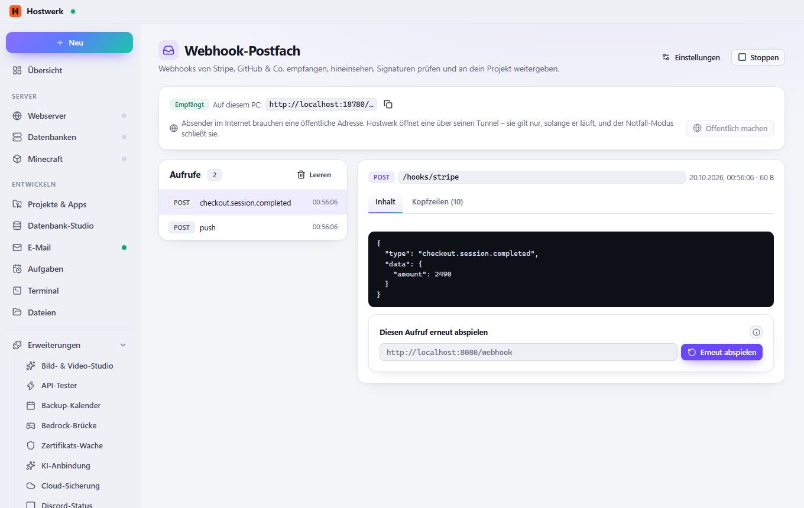

# Webhook-Postfach

Eine Adresse, an die Stripe, GitHub, Shopify, Slack & Co. ihre Webhooks schicken – auf Wunsch öffentlich über Hostwerks Tunnel. Jeder Aufruf mit Kopfzeilen und Inhalt, Signaturen prüfen, an dein Projekt weiterleiten oder erneut abspielen.

[English](README.md) · Offizielle [Hostwerk](https://github.com/Passimoritz/hostwerk-public)-Erweiterung (native Erweiterung, ab Hostwerk 2.11)



## Was sie kann

- **Wo:** Projekte → Webhooks – seit 1.4.0 ohne eigenen Seitenleisten-Eintrag; die ganze Seite bleibt unter Erweiterungen → Öffnen
- Ein Empfänger auf diesem PC (Port frei wählbar) – mit einem Klick öffentlich über Hostwerks Tunnel, der Notfall-Modus schließt ihn mit
- Eine feste Adresse mit eigener Domain (Livebetrieb → Fernzugriff), die sich nie ändert – Signaturen bleiben gültig
- Jeder Aufruf mit Methode, Pfad, Kopfzeilen und Inhalt; JSON lesbar; Suche und Filter nach Ereignis
- Signatur-Prüfung für GitHub, Stripe, Shopify, Slack, Twilio, Discord und beliebige HMAC-Kopfzeilen
- **Mehrere Pfade** (z. B. `/stripe` und `/github`), jeder mit eigener Antwort, Weiterleitung und Signaturprüfung
- Jeden Aufruf an dein Projekt weiterleiten – der Absender bekommt **sofort** seine Antwort, dein Projekt den Aufruf gleich danach (auf Wunsch stattdessen die Antwort deines Projekts, mit ihrem Content-Type); gespeicherte Aufrufe später erneut abspielen
- Antwort nach Wunsch (Status, Typ, Inhalt), damit der Absender zufrieden ist
- **Geheimnisse bleiben geheim:** Signatur-Schlüssel und Anmelde-Kopfzeilen gespeicherter Aufrufe (Authorization, Cookie, API-Schlüssel …) liegen verschlüsselt auf der Platte und erscheinen in der Oberfläche nur als „••••••“

## Installieren

In Hostwerk: **Erweiterungen → Entdecken** und „Installieren“ klicken.

Native Erweiterungen laufen als Teil von Hostwerk (eigener Server- und Oberflächen-Teil). Deshalb installiert Hostwerk sie nur aus dem offiziellen Katalog (mit Prüfsumme) oder im Entwickler-Modus.

## Daten

`data/webhook-inbox` – Einstellungen und die letzten 200 Aufrufe; Geheimnisse darin mit Hostwerks Schlüssel versiegelt (ältere Daten werden beim ersten Start versiegelt). Beim Entfernen der Erweiterung bleiben sie erhalten.

## Entwickeln

```bash
node --test tests/*.test.js          # Tests
node build-native.js .               # Oberfläche bauen (sdk/build-native.js aus hostwerk-public)
node check.js . --strict             # dieselbe Prüfung wie der Katalog (sdk/check.js)
```

Oberfläche in `ui/src`, Server-Teil in `server/`. Texte im Code sind Englisch, Deutsch steht in `locales/de.json`.

## Lizenz

MIT
