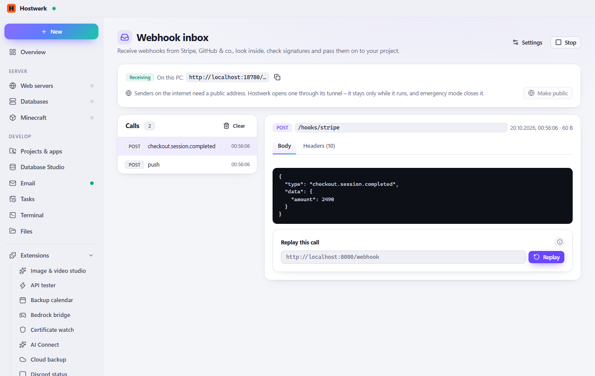

# Webhook inbox

An address for the webhooks of Stripe, GitHub, Shopify, Slack & co. – public through Hostwerk's tunnel if you like. Every call with headers and body, check signatures, forward to your project or replay.

[Deutsch](README.de.md) · An official [Hostwerk](https://github.com/Passimoritz/hostwerk-public) extension (SDK 2.7, native extension)



## What it does

- A local receiver (port of your choice) – public with one click through Hostwerk's tunnel, closed again by emergency mode
- A fixed address with your own domain (Live → Remote access) that never changes – signatures stay valid
- Every call with method, path, headers and body; JSON shown readably; search and filter by event
- Signature check for GitHub, Stripe, Shopify, Slack, Twilio, Discord and any HMAC header
- **Several paths** (e.g. `/stripe` and `/github`), each with its own answer, forwarding and signature check
- Forward each call to your project – the sender gets its answer **at once**, your project gets the call right after (or, if you want, your project's answer with its content type); replay stored calls later
- Answer of your choice (status, type, body) so the sender is happy
- **Secrets stay secret:** signature keys and login headers of stored calls (Authorization, Cookie, API keys …) are encrypted on disk and only shown as “••••••”

## Install

In Hostwerk: **Extensions → Discover** and click “Install”.

Native extensions run as part of Hostwerk (own server and interface part). That is why Hostwerk only installs them from the official catalogue (with checksum) or in developer mode.

## Data

`data/webhook-inbox` – settings and the last 200 calls; secrets in them are sealed with Hostwerk's key (older data gets sealed on the first start). Removing the extension keeps them.

## Develop

```bash
node --test tests/*.test.js          # tests
node build-native.js .               # build the interface (sdk/build-native.js from hostwerk-public)
node check.js . --strict             # same check as the catalogue (sdk/check.js)
```

Interface source in `ui/src`, server part in `server/`. Texts in the code are English, German is in `locales/de.json`.

## License

MIT
